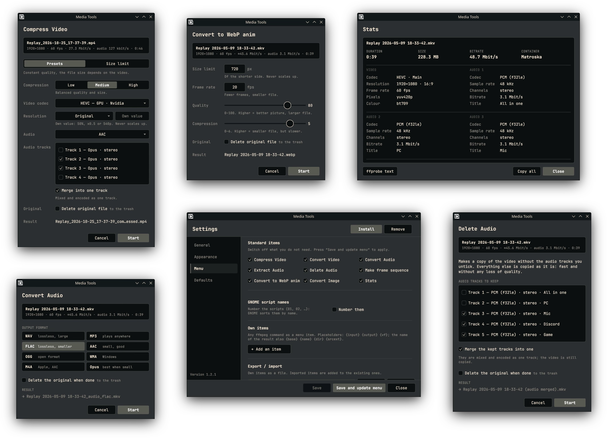

# [](https://github.com/Woysful/FFcut/releases) Media Tools

Adds ffmpeg actions to the context menu of your file manager: compress, convert, extract audio and more.
Works with Windows, KDE (Dolphin), GNOME (Files), XFCE (Thunar), on x86 and ARM.



## Install

**Linux**

1. Install `ffmpeg` with your package manager.
2. [Download](https://github.com/woysful/context-menu-media-tools/release) app the for your machine. 
3. Make it executable (you can install AppImage with GearLever), start it and press **Install** in the window that opens.

   Or do it in a terminal:

   ```
   chmod +x cmmt-linux-x86_64.AppImage
   ./cmmt-linux-x86_64.AppImage install
   ./cmmt-linux-x86_64.AppImage uninstall
   ```
   > The **Install** button doesn't install the app itself, it creates items inside context menu. So, don't forget to uninstall those items before deleting the app.

4. Restart file manager.

**Windows**
1. [Download app](https://github.com/woysful/context-menu-media-tools/releases/latest/download/cmmt-windows-x86_64.exe) and place it where you like. For example `C:\Program Files\cmmt\`
2. Download ffmpeg and put `ffmpeg.exe` with `ffprobe.exe` next to `cmmt.exe`.
   
   Or instead you can add them to `PATH`.
3. Start `cmmt.exe` and press **Install**.

   > The **Install** button doesn't install the app itself, it creates items inside context menu. So, don't forget to uninstall those items before deleting the app.

4. Restart windows explorer process of log out/in.


On Windows 11 the items are under *Show more options*.

>`install --path` also makes `cmmt` available in a terminal.

## Menu items

| Item | What it does |
|---|---|
| Compress Video | quality level or a size limit in MB (e.g. Discord), codec on CPU or GPU (Nvidia, AMD, Intel, Raspberry Pi), resolution, audio (copy, none, AAC, Opus, MP3, AC-3, E-AC-3, FLAC, ALAC, PCM); for files with several audio tracks, which tracks to keep and whether to merge them into one |
| Convert Video | MP4, AVI, MOV, MKV, M4V, WebM |
| Convert Audio | WAV, MP3, FLAC, AAC, OGG, WMA, M4A, Opus; for videos, only the audio tracks are converted |
| Extract Audio | MP3, AAC, Opus, WAV, M4A, MKA |
| Delete Audio | the video without the audio tracks you untick; the kept tracks can be merged into one |
| Make frame sequence | PNG / JPG / WebP frames in a new folder |
| Convert to WebP anim | size, fps, quality, compression |
| Convert Image | JPG, PNG, BMP, TIFF, GIF, WebP, TGA |
| Stats | duration, size, bitrate and streams of the files, plus the full `ffprobe` output |

Existing files are never overwritten: the result gets a name like `clip_compressed (1).mp4`.

Every option window has **Delete the original when done**: after a successful result the original file goes
to the trash, or is deleted permanently if you choose that under *Settings → General → Deleting originals*.
When the trash cannot be used (e.g. a system drive), the original stays and the log says why.

Right-click a field of an option window to make its current value the default (**Save as default**)
or to go back to the built-in value (**Reset to standard**).

## Settings

Start `cmmt` without arguments or open **Media Tools** from the application menu.
Here you set the theme, accent colour and interface scale, turn off menu items you don't need, add your own items
with any ffmpeg command, and set the paths to ffmpeg / ffprobe. The *Defaults* page lists the default values you saved:
change or remove them, or export them to a file as a backup and import them again.

Once a day the Settings window checks GitHub for a newer release (with `curl`).
If there is one, a dot and a link appear above the version number. You can turn this off under *General → Updates*.

Settings are stored in `~/.config/cmmt/` (Windows: `%APPDATA%\cmmt\`).

## Editing the commands

```
cmmt config --init    # writes presets.toml with all commands to the settings folder
```

Each action is a table with a full ffmpeg command line:

```toml
[compress.h264_cpu]
label = "H.264"
command = 'ffmpeg -n -i {input} {vf} -pix_fmt yuv420p -c:v libx264 -crf {q} {output}'
output = "{base}_compressed.mp4"
q = [22, 30, 35]    # low / medium / high
```

Your file only needs the entries you changed, and everything else comes from the built-in defaults.
If the file contains an error, the program ignores it and shows what is wrong.
The comments in the file list the placeholders (`{input}`, `{output}`, `{base}`, `{vf}`, `{q}`, …) and options.
To add a format or preset, add a new table.

## Command line

```
cmmt compress --cli --limit 20 --codec h265_cpu video.mp4    # no window, progress in the terminal
cmmt convert-audio --yes --format mp3 song.wav               # no options dialog
cmmt delete-audio --cli --merge --delete-original film.mkv   # one mixed track, the original to the trash
cmmt help
```

## Build

```
./build.sh            # for this computer
./build.sh --all      # every target that can be built here
./build.sh --list     # what each target needs
```

Requires Rust. Cross builds use `cargo-zigbuild` + `zig`. The results go to `dist/`.

## Status

Tested on Linux x86_64 (KDE, GNOME, XFCE). Not tested yet: Windows, Raspberry Pi / PCManFM, ARM builds,
AMD / Intel GPU encoding.
